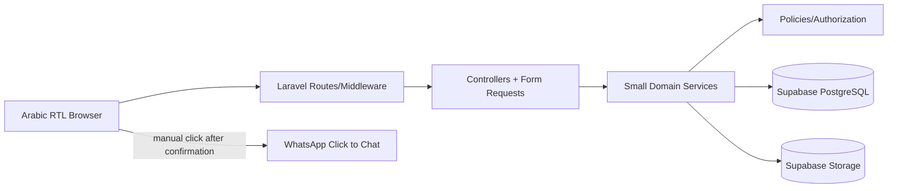

# System Architecture

## 1. Overview

The application is a modular Laravel 13 monolith using Blade and Tailwind CSS. Laravel owns routing, sessions, authentication, authorization, validation, business rules, database access, transactions, and storage orchestration. Supabase PostgreSQL owns relational persistence and constraints. Supabase Storage owns image objects. The browser renders Arabic RTL HTML and may use small JavaScript enhancements, but it never performs privileged database or storage operations directly.

## 2. Boundaries and responsibilities

Blade layouts/components handle presentation and Arabic text. Controllers coordinate requests and responses. Form Requests validate input. Policies/middleware enforce ownership and admin access. Services are reserved for multi-step operations such as order creation, storage replacement, WhatsApp message construction, and dashboard aggregates. Eloquent models define relationships and casts, while database constraints remain authoritative. Do not add a SPA, microservices, or a second authentication system.

## 3. Request flows

A public request passes through web middleware, controller validation/query scopes, and a Blade view. A state-changing request requires CSRF, authentication where appropriate, authorization, validation, and a redirect with a safe Arabic flash message. Customer order routes additionally verify `order.user_id === auth()->id()` through policy/query scoping. Admin routes use an `admin` middleware and policies.

## 4. Authentication and authorization

Use Laravel session auth, hashed passwords, session regeneration, logout invalidation, and CSRF. Registration and login are rate-limited as appropriate. Customer policies restrict orders, invoices, and account data to the authenticated owner. Admin policies protect every CRUD and status/payment action. Hiding a button is never considered authorization.

## 5. Catalog and storage flow

Admin upload request -> authenticated admin middleware -> MIME/size/dimension validation -> generated UUID path -> Laravel Supabase Storage adapter/API using server credentials -> metadata persisted in PostgreSQL -> public URL/path rendered. Replacement stores the new object before deleting the old referenced object. Failure leaves the old metadata/object usable and records an error. Public URLs expose only intended public objects.

## 6. Order creation flow

1. Customer submits checkout with CSRF and one-time submission token.
2. Form Request validates address, contact, optional wallet, and token.
3. Authorization confirms authenticated customer.
4. Service starts a PostgreSQL transaction.
5. Service loads cart products and authoritative current prices/statuses.
6. Service rejects unavailable products and recalculates decimal totals.
7. Service creates order with currency/customer/address snapshots.
8. Service creates order items with product name/price snapshots.
9. Service records initial status/history and clears cart.
10. Transaction commits; response shows confirmation.
11. A separate GET/action creates a WhatsApp URL from saved order values.

Any failure rolls back the order and items. WhatsApp is never opened as if an unsuccessful transaction succeeded. Duplicate protection uses a one-time token/session and a unique order number; exact retry behavior must be covered by integration tests.

## 7. WhatsApp flow

Laravel builds an Arabic message from the persisted order, URL-encodes it, and returns a standard `https://wa.me/{number}?text={encoded}` link. The application may record `whatsapp_opened_at` only when the customer clicks the application link; this is an attempted opening, not delivery. It does not change payment/order status. If the number is absent, the action is unavailable with a clear explanation.

## 8. Invoice flow

Customer or authorized admin requests an order invoice -> policy check -> load order and snapshots -> render RTL Blade invoice -> browser print CSS and optional client-side image export. Current products/settings are not queried for historical monetary values except for non-authoritative display metadata. Do not introduce a separate invoice table unless later requirements require immutable invoice numbering beyond order numbers.

## 9. Configuration and security

`.env` contains PostgreSQL connection settings, Supabase URL, server-side storage credentials, and app secrets. Only public asset URLs/paths appear in HTML. Production disables debug, uses HTTPS, secure cookies, trusted hosts, restricted CORS if needed, backups, and secret management. Logs include request/order identifiers but not passwords, tokens, database strings, service keys, or full sensitive customer data.

## 10. Architectural constraints

Laravel 13 and compatible PHP remain the target. Supabase PostgreSQL and Storage are mandatory unless a documented blocker is approved. Do not substitute MySQL merely because XAMPP is installed. Keep identifiers and technical docs in English, interface in Arabic, and verify every dependency against the actual environment before implementation.
